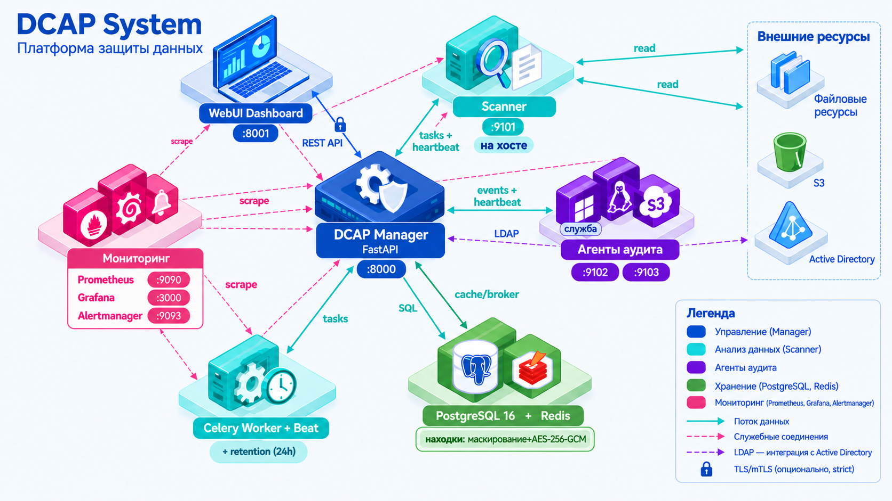

# DCAP — Data Classification & Audit Platform

[](CHANGELOG.md)
[](LICENSE)
[](pyproject.toml)
[](docker-compose.yml)
[](tests/)

> **DCAP** ‚Äî ü–ª–∞—Ç—Ñ–æ—Ä–º–∞ –∞—É–¥–∏—Ç–∞ –¥–∞–Ω–Ω—ã—Ö –Ω–∞ –ø—Ä–µ–¥–º–µ—Ç –∫–æ–Ω—Ñ–∏–¥–µ–Ω—Ü–∏–∞–ª—å–Ω–æ–π –∏–Ω—Ñ–æ—Ä–º–∞—Ü–∏–∏ (PII, credentials,
> code secrets) –∏ —Ä–∞–∑—Ä–µ—à–µ–Ω–∏–π –Ω–∞ —Ñ–∞–π–ª–æ–≤—ã—Ö —Ö—Ä–∞–Ω–∏–ª–∏—â–∞—Ö –∏ S3/MinIO. Enterprise-ready: RBAC, mTLS,
> —Å–æ–æ—Ç–≤–µ—Ç—Å—Ç–≤–∏–µ —Ä–µ–≥—É–ª—è—Ç–æ—Ä–∞–º (152-–§–ó / GDPR / PCI DSS), retention, Prometheus/Grafana.

## ‚ú® –í–æ–∑–º–æ–∂–Ω–æ—Å—Ç–∏

- **Сканер** — PII (FИО, email, телефоны, паспорта, СНИЛС, ИНН, банковские карты), credentials
  (API-–∫–ª—é—á–∏, –ø–∞—Ä–æ–ª–∏, SSH, —Ç–æ–∫–µ–Ω—ã), code secrets. OCR –¥–ª—è –∏–∑–æ–±—Ä–∞–∂–µ–Ω–∏–π/PDF.
- **Аудит разрешений** — файловые хранилища (Windows/Linux), S3/MinIO (streaming, multipart).
- **Шифрование** — AES-256-GCM; расшифровка только Auditor, с аудитом.
  HMAC-SHA256 fingerprint (–∑–∞—â–∏—Ç–∞ –æ—Ç brute-force). –ú–∞—Å–∫–∏—Ä–æ–≤–∞–Ω–∏–µ –∫–æ–Ω—Ç–µ–∫—Å—Ç–æ–≤
  –Ω–∞ —Å—Ç–æ—Ä–æ–Ω–µ Manager (BUG-117).
- **Дашборд** — фильтры по findings, статистика, экспорт; аудит Windows/Linux/S3.
- **RBAC** — admin / auditor / scanner / viewer; AD-интеграция; mTLS relaxed/strict.
- **Retention** — политики TTL, очистка, архивирование, Celery Beat.
- **Мониторинг** — Prometheus /metrics, Grafana (2 дашборда, 4 алерта).
- **WebUI** — Dovetail dark, RBAC-гейты, responsive.

## ⚙️ Реквизиты<c/br>

- Docker + Docker Compose v2 (`--wait`)
- Python 3.10+ (–¥–ª—è —Å–∫–∞–Ω–µ—Ä–∞ –Ω–∞ —Ö–æ—Å—Ç–µ)
- 16 –ì–ë RAM (—Å–∫–∞–Ω–µ—Ä: `max_workers=2`; 32 –ì–ë ‚Üí 4; 128 –ì–ë ‚Üí 8)

<h3>1. –ö–ª–æ–Ω–∏—Ä–æ–≤–∞—Ç—å –∏ –Ω–∞—Å—Ç—Ä–æ–∏—Ç—å</h3>

```bash
git clone https://github.com/kirill-9999/dcap-system.git
cd dcap-system
cp .env.example .env
# –ó–∞–ø–æ–ª–Ω–∏—Ç—å: FINDINGS_ENCRYPTION_KEY, FINDINGS_HMAC_KEY (base64, 32 bytes),
#           S3_ACCESS_KEY, S3_SECRET_KEY (–µ—Å–ª–∏ S3), POSTGRES_PASSWORD
```

–ì–µ–Ω–µ—Ä–∞—Ü–∏—è –∫–ª—é—á–µ–π findings:

```bash
python -c "import base64, os; print(base64.b64encode(os.urandom(32)).decode())"
# повторить дважды — для FINDINGS_ENCRYPTION_KEY и FINDINGS_HMAC_KEY
```

<h3>2. –ü–æ–¥–Ω—è—Ç—å —Å—Ç–µ–∫</h3>

```bash
docker compose up -d --build --wait
# Manager :8000, WebUI :8001, Grafana :3000, Prometheus :9090
```

<h3>3. –ü–µ—Ä–≤—ã–π –≤—Ö–æ–¥</h3>

WebUI: http://localhost:8001

Логин: admin / admin123 — сменить при первом запуске (Settings → Password).

<h3>4. –ó–∞–ø—É—Å—Ç–∏—Ç—å —Å–∫–∞–Ω–µ—Ä (–Ω–∞ —Ö–æ—Å—Ç–µ)</h3>

```bash
export FINDINGS_ENCRYPTION_KEY="<base64>"
export FINDINGS_HMAC_KEY="<base64>"
export MANAGER_URL="http://127.0.0.1:8000"
python run_scanner.py scanner/config/scanner_config.json
```

❗️ В production сканер без ключей не стартует (fail-fast).
DCAP_ALLOW_LEGACY_SCANNER=true — только dev.

<h3>5. –°–æ–∑–¥–∞—Ç—å —Ä–µ—Å—É—Ä—Å –∏ –∑–∞–ø—É—Å—Ç–∏—Ç—å —Å–∫–∞–Ω</h3>

WebUI ‚Üí Resources ‚Üí New (filesystem path –∏–ª–∏ s3://bucket/prefix).

–ò–ª–∏ API: `POST /api/resources?path=...&type=filesystem` ‚Üí `POST /api/resources/{id}/scan`.

## 🏗️ Архитектура



–û–±—â–∞—è —Å—Ö–µ–º–∞ –≤–∑–∞–∏–º–æ–¥–µ–π—Å—Ç–≤–∏—è –∫–æ–º–ø–æ–Ω–µ–Ω—Ç–æ–≤ DCAP (Manager, Scanner, –∞–≥–µ–Ω—Ç—ã, —Ö—Ä–∞–Ω–∏–ª–∏—â–∞).

Pæ–¥—Ä–æ–±–Ω–æ–µ –æ–ø–∏—Å–∞–Ω–∏–µ (–º–æ–¥–µ–ª–∏ –¥–∞–Ω–Ω—ã—Ö, API, SIEM)‚Äî –≤ ARCHITECTURE.md –∏ docs/architecture.mermaid.

## 🧤 Тестирование

```bash
# Unit (544 passed)
pytest tests/unit -q

# E2E (—Ç–µ—Å—Ç–æ–≤—ã–π —Å—Ç–µ–Ω–¥ :18000/:18001)
scripts/test-up.sh
scripts/run-tests.sh e2e

# Security (53.5)
scripts/security_scan.ps1   # Bandit, Semgrep, Gitleaks, pip-audit, Trivy, ZAP
```

Подробнее — docs/testing.md.

## üìö –î–æ–∫—É–º–µ–Ω—Ç–∞—Ü–∏—è

-ARCHITECTUDE.md — архитектура, модели, API, SIEM.
-ROADMAP.md — план и бэклог.
-CHANGELOG.md — история изменений.
-docs/admin-guide/ — 04-authentication, 05-security, 06-scanner, 10-troubleshooting.
-docs/DESIGN.md — WebUI style reference (Dovetail).
-QM
UI%QdπµêÉäPÉBˇB˚BÔB„FB„BÎB¿ÉB«B◊BflB˚BˇB√FB˜B˚FFB‡∏(µëΩçÃΩÕïç’…•—Â}ç°ïç≠±•Õ–πµê∏((ååɬ~RPÉBGB◊BflB˚BˇB√FB˜B˚FFF0((µ•πë•πùÃËÅL¥»‘ÿµ
4ĨÅ!5µM!»‘ÿÅô•πùï…¡…•π–ÏÉBÛB√FBÎB„FB˚BÀB√B˜B„B‘ÉBˇB¯ÉFBÛB˚BÔFB√B˜B„F8∏(∑BÉB√FF#B„FFB˚BÀBÎB¿ÉäPÉFB˚BÔF3BÎB¯Å’ë•—Ω»∞ÉFÉB√FB”B„FB˚BÄ°ô•πë•πù}…ïŸïÖ∞§∏(µµQ1LÅ…ï±Ö·ïêΩÕ—…•ç–ĨÅ
I0ÏŵÖç°•πî∑F7B˜B”BˇB˚B„B˜FF,ÉBˇFB˚BÀB◊FF?F;FÉFB◊FFB„FB„BÎB√FÉB»ÅÕ—…•ç–∏(∑BCFB”B„FËÅô•πë•πùÃ∞ÅÖ’—†∞ÉFB˚BÔB‡∞Å…ï—ïπ—•Ω∏ÉäPÉÇ»ÅÖ’ë•—}±ΩùÃÄ£BˇB√FFB„FB„B˚B˜B„FB˚BÀB√B˜B„B‘§∏(¥‘Ã∏‘ËÅ	Öπë•–Ä¿Å!% ∞ÅMïµù…ï¿Ä¿∞Å•—±ïÖ≠ÃÄ¿∞Å¡•¿µÖ’ë•–Ä¿∞ÅQ…•Ÿ‰Ä¿Å
I%Q%
0∞(ÄÅi@Ä¿Å!% ∞Å
Ö¡…Ω¿ım11t∞ÅπΩ∏µ…ΩΩ–∏(∑äjÉæ‚<ÄΩµï—…•çÃÉBˇFB«BÔB„FB˜F/B‰Ä°	
-1=¥¿––§ÉäPÉBflB√BÎFF/FF0ÉB»Å¡…Ωë’ç—•Ω∏∏(∑äjÉæ‚<ÅÖ뵕∏ΩÖ뵕∏ƒ»ÃÉäPÉFBÛB◊B˜B„FF0ÉBˇFB‡ÉBˇB◊FBÀB˚BÉBflB√BˇFFBÎB‘∏(µroBÁB”B◊B˜B˜F/B‘ÉFF?BflBÀB„BÛB˚FFB‡ÉäPÉFB∏ÅM
UI%Qdπµê∏((ååɬ~íTÅ
Ωπ—…•â’—•πú()Ω…¨ÉäHÅâ…Öπç†ÉäHÅAH∏(+BãB◊FFF,ËÅš—ïÕ–Å—ïÕ—ÃΩ’π•–ĵ≈ÄĨÅÅÕç…•¡—ÃΩ…’∏µ—ïÕ—ÃπÕ†Åî…ïÄÄ£BˇFB‡ÉBˇFB◊B”FFBÔB˚BÀB„F?F§∏(+BáFB„BÔF0ËÅA@ć∞ŗ¡îÅ°•π—Ã∞űΩùùï»ÉBÀBÛB◊FFB¯Å¡…•π–∏()Mïç’…•—‰∑BˇFB√BÀBÎB‡ÉäPÅÃÄåÅπΩÕïµù…ï¿Ä¨ÉBÎB˚BÛBÛB◊B˜FB√FB„B◊BÄ£B◊FBÔB‡ÉB˚FB˚BflB˜B√B˜B˜B¯§Ä∏()
$ÉäPÅ•—!’àÅç—•ΩπÃÄ°	
-1=¥¿–ÿ∞ÉB”B◊B˜F0Ä‘‘§∏((ååɬ~NÉBoB„FB◊B˜BflB„F<()¡Öç°îÅ1•çïπÕîÄ»∏¿∏ÉBáFB˚FB˚B˜B˜B„B‘ÉBÎB˚BÛBˇB˚B˜B◊B˜FF,ÉäPÉFB∏Å9=Q%
πµê∏((ååɬ~f<Åç≠πΩ›±ïëùïµïπ—Ã((¥Å%π—ï»Ä°…ÕµÃΩ•π—ﻧÉäPÅM%0Å=0ă∏ƒ(¥¶WFBGB◊FB„B˜FF,Å5ΩπºÉäPÅM%0Å=0ă∏ƒ(¥Å	ΩΩ—Õ—…Ö¿∞Å
°Ö…–π©Ã∞ÅΩπ–Å›ïÕΩµîÉäPÅ5%PĺÅ	MÄ£FB∏Å9=Q%
πµê§((ååɬ~N∞ÉBkB˚B˜FB√BÎFF,()%ÕÕ’ïÃËÅ°——¡Ã˺Ωù•—°’àπçΩ¥Ω≠•…•±∞¥‰‰‰‰ΩëçÖ¿µÕÂÕ—ï¥Ω•ÕÕ’ïÃ()Mïç’…•—‰ËÉFB∏ÅM
UI%Qdπµ
