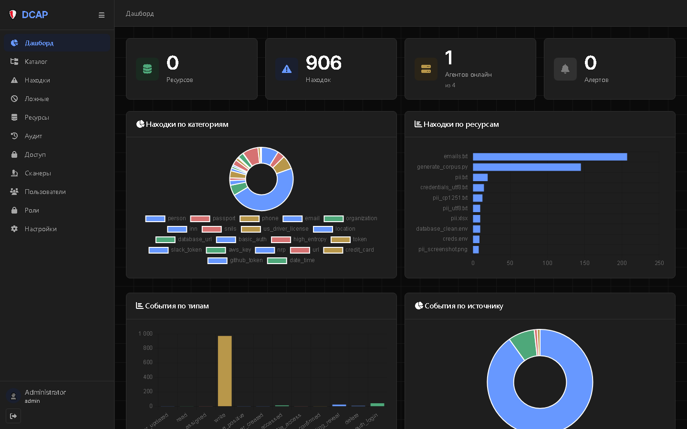
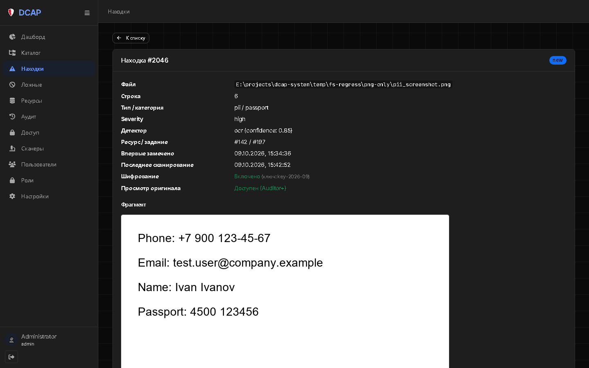
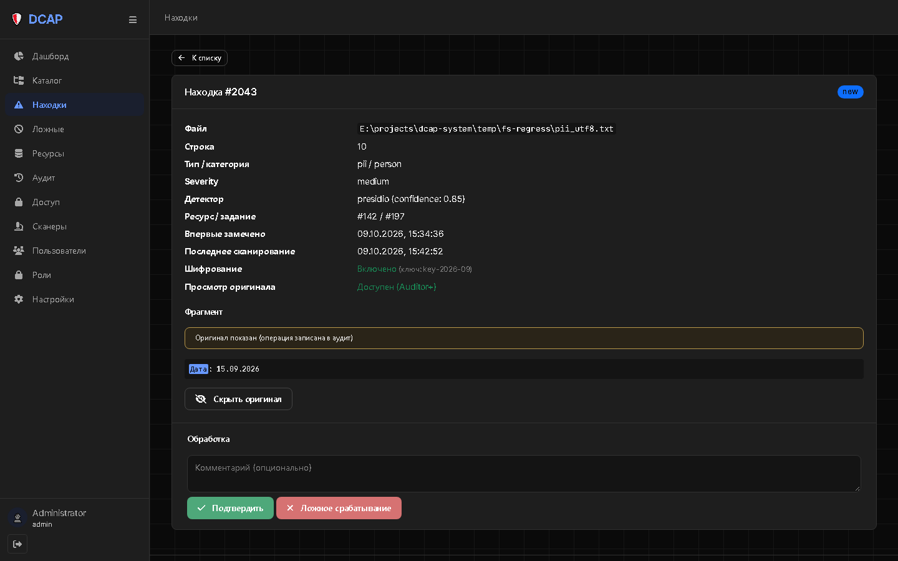
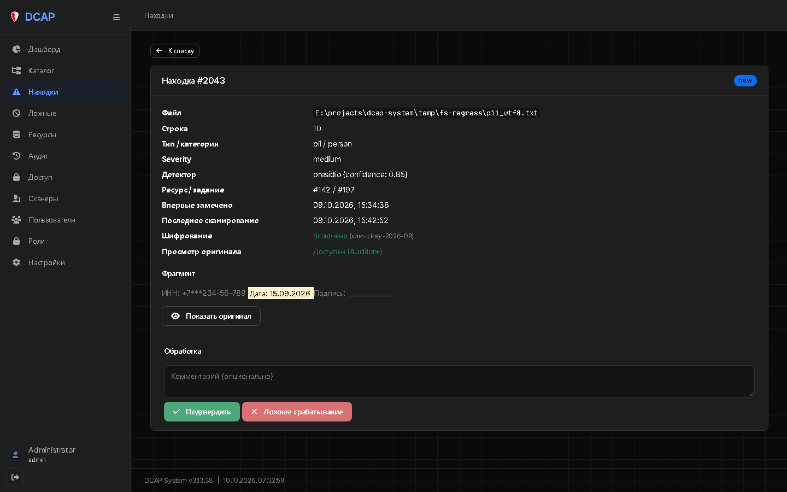

# Отчёт: День 53.4a-доп — WebUI-фиксы (BUG-138/139/140)

- **Дата:** 10.10.2026
- **Версия:** v3.13.37 → **v3.13.38**
- **Статус:** ✅ Выполнено
- **ТЗ:** `prompts/archive/day_53_4a_add_webui_fixes.md`
- **Родительская задача:** BACKLOG-093 «WebUI-редизайн (Dovetail-style, `DESIGN.md`)», этап 1/5 — доработка
- **Ветка:** `feature/day_53_4a_add_webui_fixes`

---

## 🎯 Цель

Закрыть три дефекта приёмки 53.4a:

- **BUG-139** — `webfonts/` пуст → sidebar-иконки рендерились как цветные emoji.
- **BUG-138** — `finding_detail.js` содержал `onerror="… </div> …"` → браузер рвал атрибут → `SyntaxError` в Console.
- **BUG-140** — reveal-логика: лишняя кнопка для `image_region`, безвозвратная перезапись `#fragment`, спам аудита, дубль `line_text`/`match_text`, `bg-light` на тёмной теме.

---

## 📁 Созданные / изменённые файлы

### Созданы

| Файл | Назначение | Размер |
|------|------------|--------|
| `webui/static/vendor/webfonts/fa-solid-900.woff2` | FA 6.4.0 Solid (fas) | 150 124 B |
| `webui/static/vendor/webfonts/fa-solid-900.ttf` | Solid TTF-fallback | 394 628 B |
| `webui/static/vendor/webfonts/fa-regular-400.woff2` | Regular (far) | 24 948 B |
| `webui/static/vendor/webfonts/fa-regular-400.ttf` | Regular TTF | 63 952 B |
| `webui/static/vendor/webfonts/fa-brands-400.woff2` | Brands (fab) | 108 020 B |
| `webui/static/vendor/webfonts/fa-brands-400.ttf` | Brands TTF | 187 208 B |

### Изменены

| Файл | Что |
|------|-----|
| `webui/static/js/finding_detail.js` | BUG-138: `onerror` → `addEventListener('error', …, {once:true})`, убран `src=""`, `data-bbox` экранирован. BUG-140: кнопка reveal скрыта для `image_region`, toggle + кэш, подсветка match `<mark>` |
| `webui/static/css/findings.css` | `.reveal-block` + `mark` вместо `bg-light` |
| `.env`, `.env.example`, `docker-compose.yml`, `docker-compose.s3.yml`, `docker-compose.test.yml` | `VERSION=3.13.38`, образы `dcap/*:3.13.38` |

### Не изменялись

`fontawesome.min.css` (уже ссылался на `../webfonts/…`), `components/*.css`, `tokens.css`,
`base.css`, `components.css`, `grid-wireframe.css`, разметка страниц, backend
(`manager/src/api/findings.py`).

---

## 🔑 Ключевые решения

1. **BUG-139 (webfonts):** файлы FA 6.4.0 уже лежали в `webui/static/vendor/webfonts/` — причина
   «цветных emoji» была в пустом каталоге (браузер падал в системный emoji-font). `.dockerignore`
   `woff2`/`vendor` не блокирует → достаточно пересборки образа.
2. **BUG-138:** обработка ошибки изображения переведена на `img.addEventListener('error', …)` —
   создание `<div class="alert alert-warning">` через DOM API (`meta.insertAdjacentElement('beforebegin', …)`),
   никакого HTML внутри JS-атрибута. `src=""` убран (не триггерит ошибку мгновенно).
3. **BUG-140 (reveal toggle):** исходный HTML `#fragment` сохраняется в `fragmentOriginalHTML` и
   восстанавливается без POST; результат reveal кэшируется в `cachedReveal` → повторные клики
   **не** пишут дублей `finding_reveal` в `audit_logs`. `line_text`/`match_text` не выводятся
   дважды: если match ⊂ line — match подсвечивается `<mark>` внутри line.
4. **`image_region`:** кнопка reveal скрыта (`f.can_reveal && f.fragment_type !== 'image_region'`) —
   PNG уже оригинал.
5. **`bg-light` → `.reveal-block`** в `findings.css` (`--color-deep-coal` + `--color-snow`,
   `<mark>` = cornflower `#6798ff`).
6. **TASK-204 (диагностика):** `/reveal` возвращает `decrypt(line_text_encrypted)` — полную
   сохранённую строку без урезания. У finding 2043 сохранённая строка и есть `"Дата: 15.09.2026\r"`
   (контекст вокруг — в `context_before`/`context_after`). Это **FP presidio `person="Дата"`** →
   **TEST-NOTE-10.15** (отдельный день «Качество детекции»), backend **не** правили.
7. **Версия:** `VERSION=3.13.38` в `.env`/`.env.example`/compose; весь стек пересобран
   (`docker compose build` + `up -d`): `dcap/manager:3.13.38`, `dcap/webui:3.13.38`.

---

## 🧪 Критерии приёмки

| # | Критерий | Результат |
|---|----------|-----------|
| 1 | `vendor/webfonts/` — 6 файлов (3×woff2 + 3×ttf) | ✅ (размеры см. выше) |
| 2 | WebUI-контейнер пересобран, healthy | ✅ `dcap-webui` `dcap/webui:3.13.38` (healthy) |
| 3 | DevTools → Network: `fa-solid-900.woff2` → 200 | ✅ HTTP 200, 150 124 B |
| 4 | Sidebar-иконки серые, активный — cornflower | ✅ Computed: 12 иконок `rgb(167,167,167)` (`#a7a7a7` = `--color-ash`); активный `fa-chart-pie` `rgb(103,152,255)` (`#6798ff` = cornflower), фон активного `rgb(26,31,46)`; `display: inline-block` (веб-глифы, не emoji) |
| 5 | Console на `/findings/2046` — пусто | ✅ 0 ошибок (Runtime.exceptionThrown / console.error / Log.error) |
| 6 | `/findings/2046` — фрагмент PNG отображается | ✅ `#fragment-image` виден (`display: ''`), img-блоб загружен |
| 7 | `/findings/2043` — `text_line`, кнопка reveal есть | ✅ `reveal_btn=True` (для `image_region` скрыта — это корректное поведение) |
| 8 | `/findings/2046` (image_region) — кнопки reveal нет | ✅ `reveal_btn=False` |
| 9 | Reveal toggle «Показать ⇄ Скрыть» | ✅ клик → «Скрыть оригинал» + `#fragment` = расшифрованная строка; клик → «Показать оригинал» + `#fragment` = маскированный `ИНН: +7***234-56-789 Дата: 15.09.2026…` |
| 10 | Повторные клики reveal без дублей в аудите | ✅ CDP: 3 клика (показать→скрыть→показать) → **1** запись `finding_reveal`. SQL: 2 записи за 15 мин = 1 (мой прямой API-тест) + 1 (браузерная сессия из 3 кликов) |
| 11 | `line_text` + `match_text` не дублируются | ✅ один `<pre class="reveal-block">` с `<mark>`-подсветкой match внутри line |
| 12 | Никаких `bg-light` на тёмной теме | ✅ в `finding_detail.js` нет `bg-light`; в `findings.css` упоминание только в комментарии |
| 13 | Unit-набор — 433 passed | ✅ **433 passed** (290.35s) |

### SQL-проверка аудита (критерий 10)

```
SELECT id, created_at, metadata->>'finding_id', metadata->>'action'
FROM audit_logs
WHERE event_type='finding_reveal' AND created_at > now() - interval '15 minutes';

 1847 | 2026-10-10 04:31:45 | 2043 | finding_revealed   <- прямой API-тест
 1850 | 2026-10-10 04:33:03 | 2043 | finding_revealed   <- браузер: 3 клика = 1 POST
```

---

## 📸 Скриншоты

| Момент | Скриншот |
|--------|----------|
| Sidebar после (иконки монохромные, активный — cornflower) |  |
| `/findings/2046` (image_region, без кнопки reveal, PNG) |  |
| `/findings/2043` — маскированный фрагмент |  |
| `/findings/2043` — после «Показать оригинал» (toggle) |  |
| `/findings/2043` — после «Скрыть оригинал» |  |

---

## ⚠️ Известные ограничения

- **Предоставлено архитектору (TASK-204).** `/reveal` возвращает полный сохранённый `line_text` —
  это не баг проки. Короткое значение у 2043 — FP presidio `person="Дата"` → **TEST-NOTE-10.15**
  (отдельный день «Качество детекции»).
- Качество детекции (~40 % FP: url, organization, us_driver_license, nrp) — TEST-NOTE-10.15.
- Chart.js — палитра не под Dovetail → 53.4d.
- Grid-wireframe тонкий → 53.4e.
- FA-иконки остаются (переход на stroke-SVG — BACKLOG-101, v3.1.0).

---

## 🔧 Как запустить / проверить

```powershell
docker compose build webui
docker compose up -d --force-recreate webui
# http://localhost:8001/login (admin / admin123)

# /findings/2046 — Ctrl+F5: Console пусто, PNG виден, кнопки reveal нет
# /findings/2043 — Ctrl+F5: кнопка «Показать оригинал», toggle работает
# /            — Ctrl+F5: sidebar-иконки серые, активный пункт cornflower
# DevTools → Network → filter woff2: fa-solid-900.woff2 (150 KB), inter.woff2, jetbrains-mono.woff2 — 200

pytest tests/unit/ -q      # 433 passed
```

---

## 💾 Коммит

```bash
git checkout -b feature/day_53_4a_add_webui_fixes

git add webui/static/vendor/webfonts/ \
        webui/static/js/finding_detail.js \
        webui/static/css/findings.css \
        .env.example docker-compose.yml docker-compose.s3.yml docker-compose.test.yml \
        STATE.md CHANGELOG.md ROADMAP.md \
        prompts/reports/day_53_4a_add_webui_fixes_report.md \
        prompts/reports/assets/day_53_4a_add_webui_fixes/

git commit -m "fix: 53.4a-доп — WebUI fixes (BUG-138/139/140)

- BUG-139: Font Awesome webfonts (6 файлов, FA 6.4.0) — sidebar monochrome,
  соответствует DESIGN.md (--color-ash + --color-blue-cornflower)
- BUG-138: finding_detail.js — onerror через addEventListener,
  убран HTML в атрибуте (устранён SyntaxError: missing ) after argument list)
- BUG-140: reveal-логика в finding_detail.js:
  - для fragment_type=image_region кнопка reveal СКРЫТА (PNG = оригинал)
  - toggle «Показать / Скрыть» без перезаписи #fragment
  - кэш reveal — повторные клики не спамят audit_logs
  - устранено дублирование line_text/match_text (подсветка <mark>)
  - .reveal-block вместо bg-light (тёмная тема)
- findings.css: .reveal-block + <mark>
- VERSION 3.13.38 (.env/.env.example/compose)

Backlog: BACKLOG-093 (этап 1/5, доработка)
docs: обновлены STATE.md (v3.13.38), CHANGELOG.md, ROADMAP.md"
```