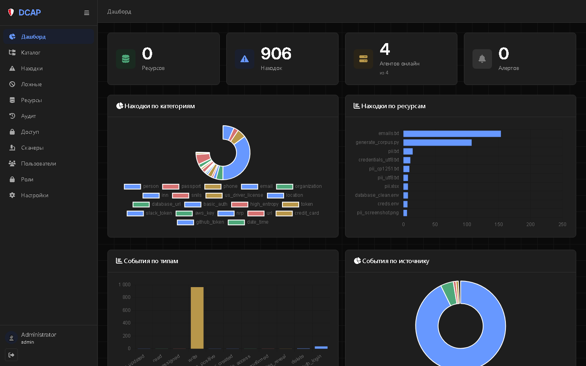
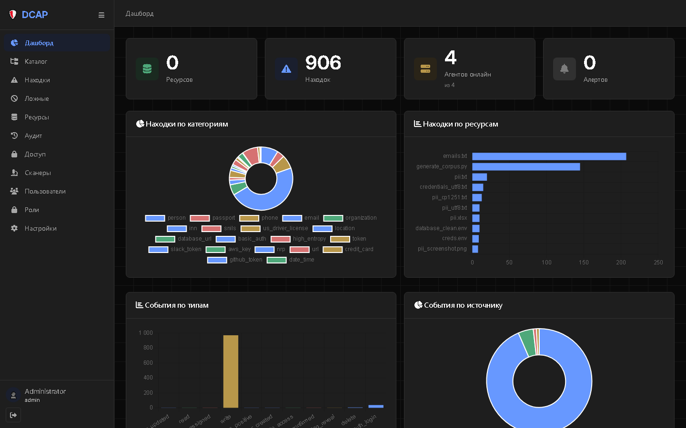
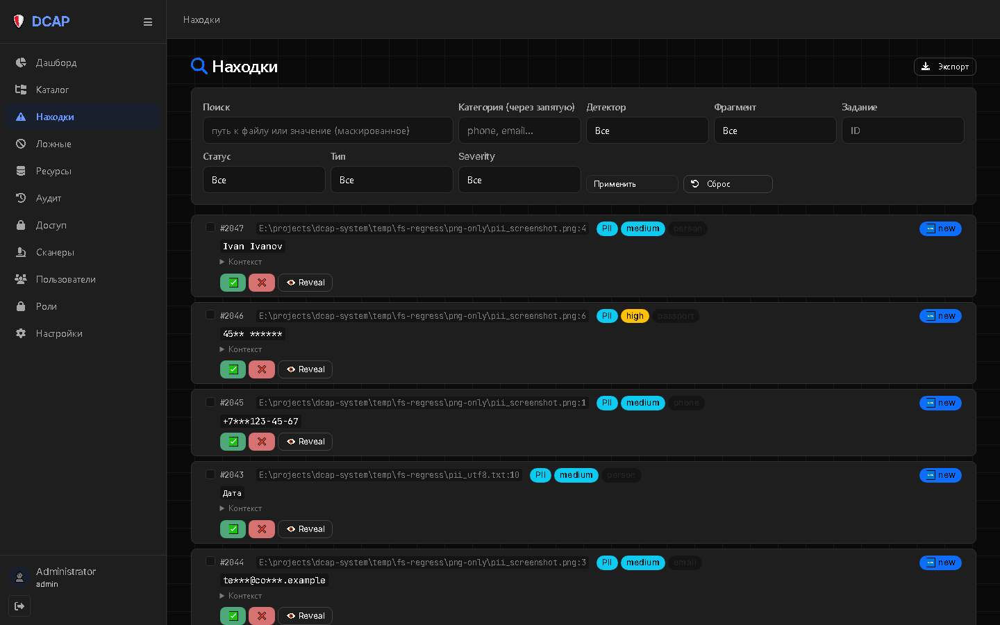
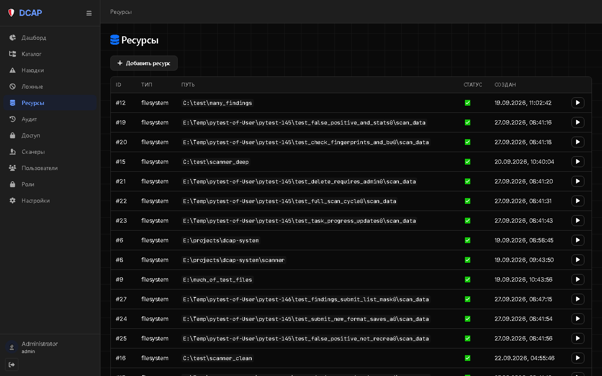
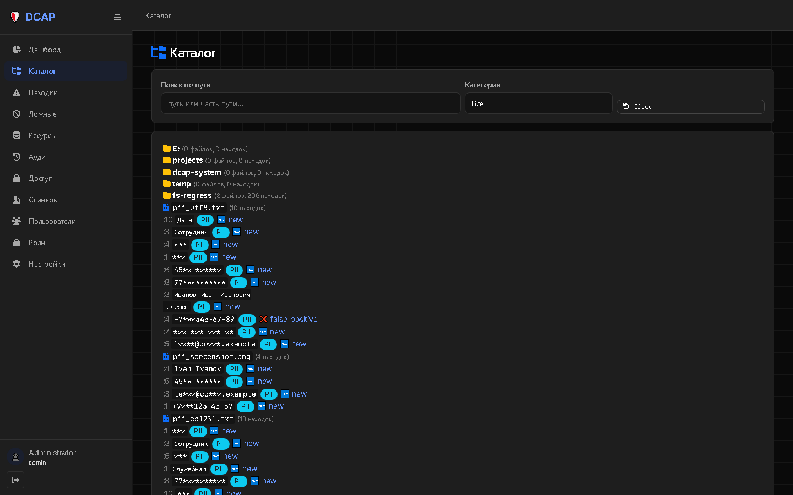
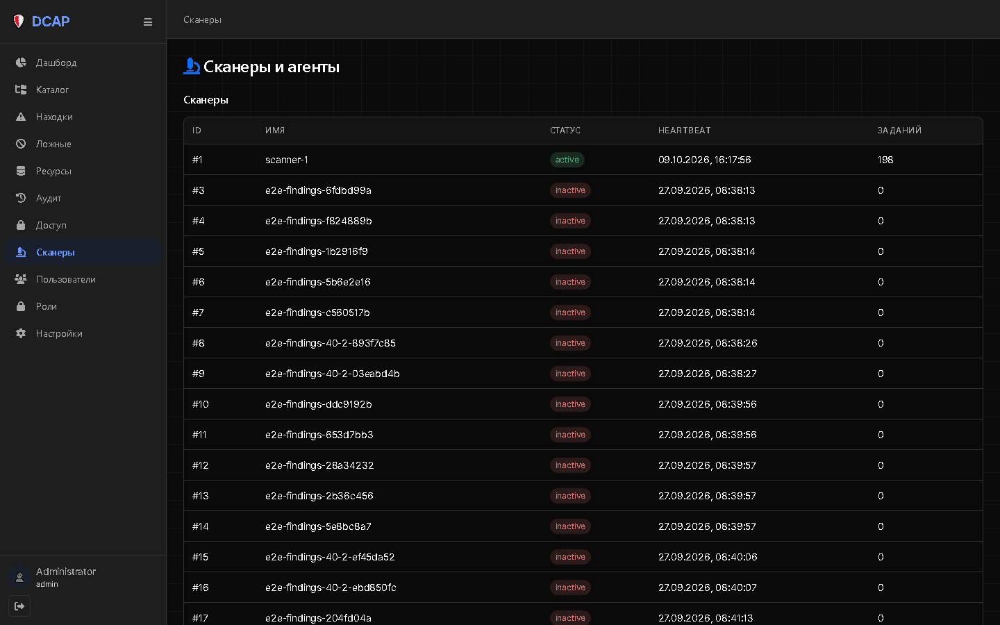

# Отчёт: День 53.4a — WebUI-редизайн, этап 1: токены + base + компоненты

- **Дата:** 09.10.2026
- **Версия:** v3.13.36 → **v3.13.37**
- **Статус:** ✅ Выполнено
- **ТЗ:** `prompts/archive/day_53_4a_webui_tokens.md`
- **Родительская задача:** BACKLOG-093 «WebUI-редизайн (Dovetail-style, `DESIGN.md`)», этап 1 из 5
- **Ветка:** `feature/day_53_4a_webui_tokens`

---

## 🎯 Цель

Перевести WebUI DCAP на тёмную тему Dovetail (`DESIGN.md`) через общий слой токенов,
`base.css` и override-компонентов — без переписывания страниц и JS. Все 14 страниц
подхватывают переменные автоматически.

---

## 📁 Созданные / изменённые / удалённые файлы

### Созданы

| Файл | Назначение | Размер |
|------|------------|--------|
| `webui/static/vendor/fonts/inter.woff2` | Inter Variable | 352 240 B |
| `webui/static/vendor/fonts/inter.css` | `@font-face` Inter | 410 B |
| `webui/static/vendor/fonts/jetbrains-mono.woff2` | JetBrains Mono Variable (latin) | 40 404 B |
| `webui/static/vendor/fonts/jetbrains-mono.css` | `@font-face` JetBrains Mono | — |
| `webui/static/css/tokens.css` | CSS-переменные Dovetail (dark-only) + legacy-алиасы | 5 637 B |
| `webui/static/css/base.css` | глобальные стили, шрифты, скроллбар | 2 690 B |
| `webui/static/css/components.css` | override Bootstrap 5 | 10 377 B |
| `webui/static/css/grid-wireframe.css` | blueprint-сетка `body::before` | 857 B |

### Изменены

| Файл | Что |
|------|-----|
| `webui/templates/base.html` | `data-theme="dark"`, 4 новых `<link>`, удалены `theme.js` и кнопка темы |
| `webui/templates/login.html` | `data-theme="dark"`, 4 новых `<link>`, inline-`<style>` на токенах |
| `webui/static/css/main.css` | `@import` → `tokens/base/components/grid-wireframe`; убраны дубли глобальных правил |

### Удалены

| Файл | Почему |
|------|--------|
| `webui/static/css/variables.css` | перенесено в `tokens.css` |
| `webui/static/css/theme-dark.css` | dark-only, отдельный файл не нужен |
| `webui/static/js/theme.js` | переключателя темы больше нет |

---

## 🔑 Ключевые решения

1. **Имена legacy-переменных сохранены** (`--color-bg`, `--color-text`, `--color-surface`,
   `--color-primary`, `--font-family`, `--shadow-*`, `--radius-*`, `--spacing-1…6` и т.д.).
   Проверено grep'ом: все `var(--…)`, реально используемые в `webui/static/css/**`,
   определены в `tokens.css` → `components/*.css` и `findings.css` подхватили тёмную
   палитру **без единой правки**.
2. **`--font-mono` alias** добавлен в `tokens.css` для `findings.css` (JetBrains Mono).
3. **Тени обнулены** (`--shadow-*: none`) — Dovetail zero-shadow; поверхности разделяются тоном.
4. **Шрифты локально** (`webui/static/vendor/fonts/`), CDN запрещён. JetBrains Mono основной
   URL (`gh/JetBrains/JetBrainsMono@master/.../JetBrainsMono[wght].woff2`) вернул 404,
   поэтому использован fallback из ТЗ — Fontsource (`@fontsource-variable/jetbrains-mono`,
   latin-wght-normal). Inter скачан с `gh/rsms/inter`.
5. **`data-theme="dark"`** в `<html>` оставлен на будущее (если вернут light-тему).
6. **Нет volume-маунта** у WebUI в `docker-compose.yml` → образ пересобран
   (`docker compose build webui` + `up -d --force-recreate webui`).

---

## 🧪 Критерии приёмки

| # | Критерий | Результат |
|---|----------|-----------|
| 1 | `vendor/fonts/` содержит inter.woff2 + inter.css + jetbrains-mono.woff2 + jetbrains-mono.css | ✅ (магия `wOF2`) |
| 2 | `tokens.css`, `base.css`, `components.css`, `grid-wireframe.css` созданы | ✅ |
| 3 | `variables.css`, `theme-dark.css`, `theme.js` удалены | ✅ `git status` → `D` |
| 4 | `base.html`: `data-theme="dark"`, новые `<link>`, нет `theme.js`/кнопки темы | ✅ |
| 5 | `login.html`: `data-theme="dark"`, новые `<link>` | ✅ |
| 6 | `main.css`: импорты обновлены | ✅ |
| 7 | Login-страница тёмная | ✅ |
| 8 | Все страницы тёмные (dashboard, findings, catalog, …) | ✅ 12 маршрутов → 200, `data-theme="dark"` |
| 9 | Кнопка «Выход» в сайдбаре работает | ✅ (`Auth.logout()` сохранён) |
| 10 | Формы, модалки, таблицы — тёмные, без белых пятен | ✅ (override Bootstrap) |
| 11 | Шрифт — Inter (не системный) | ✅ Computed: `Inter, ui-sans-serif, …` |
| 12 | `code`, `pre` — JetBrains Mono | ✅ Computed: `"JetBrains Mono", ui-monospace, …` |
| 13 | Unit-набор — 433 passed | ✅ **433 passed** (114.30s) |

### Проверенные страницы (HTTP 200, `data-theme="dark"`)

`/`, `/catalog`, `/findings`, `/false-positives`, `/resources`, `/audit`, `/access`,
`/scanners`, `/users`, `/roles`, `/settings`, `/login`.

### Вычисленные стили (headless Chrome, авторизованный дашборд)

```
body font-family : Inter, ui-sans-serif, system-ui, -apple-system, ...
body background  : rgb(10, 10, 10)   (#0a0a0a)
body color       : rgb(255, 255, 255)
code font-family : "JetBrains Mono", ui-monospace, SFMono-Regular, ...
title            : DCAP — Дашборд ; activeNav: Дашборд
```

---

## 📸 Скриншоты

| Страница | Скриншот |
|----------|----------|
| Login |  |
| Dashboard |  |
| Findings |  |
| Resources |  |
| Catalog (доп.) |  |
| Scanners (доп.) |  |

---

## ⚠️ Известные ограничения (ожидаемо для 53.4a)

- **Chart.js** — дефолтная палитра не под Dovetail (графики могут «выпадать») → 53.4d.
- **Grid-wireframe** тонкий (~3 % контраста) — при необходимости усилить в 53.4e.
- **Zero-shadow** — если что-то «потеряло глубину», это ожидаемо (Dovetail).
- **`.btn-primary`** теперь `#1e1e1e` (dark carbon), а не синий — правило Dovetail.
- **Иконки FA** остаются (переход на stroke-SVG — BACKLOG-101).
- Контент страниц (разметка) не переделывался — 53.4b–53.4d.

---

## 🔧 Как запустить / проверить

```powershell
# Docker (текущий режим)
docker compose build webui
docker compose up -d --force-recreate webui
# открыть http://localhost:8001/login  (admin / admin123)

# Локально
python run_webui.py
```

DevTools → Computed для `body` → `font-family: Inter …`; для `code` → `JetBrains Mono …`.

Unit-набор:

```powershell
pytest tests/unit/ -q      # 433 passed
```

---

## 💾 Коммит

```bash
git checkout -b feature/day_53_4a_webui_tokens

git add webui/static/vendor/fonts/ \
        webui/static/css/tokens.css \
        webui/static/css/base.css \
        webui/static/css/components.css \
        webui/static/css/grid-wireframe.css \
        webui/templates/base.html \
        webui/templates/login.html \
        webui/static/css/main.css \
        STATE.md CHANGELOG.md ROADMAP.md \
        prompts/reports/day_53_4a_report.md \
        prompts/reports/assets/day_53_4a/

git rm webui/static/css/variables.css \
       webui/static/css/theme-dark.css \
       webui/static/js/theme.js

git commit -m "feat: День 53.4a — WebUI-редизайн, этап 1: токены + base + компоненты (v3.13.37)"
```
